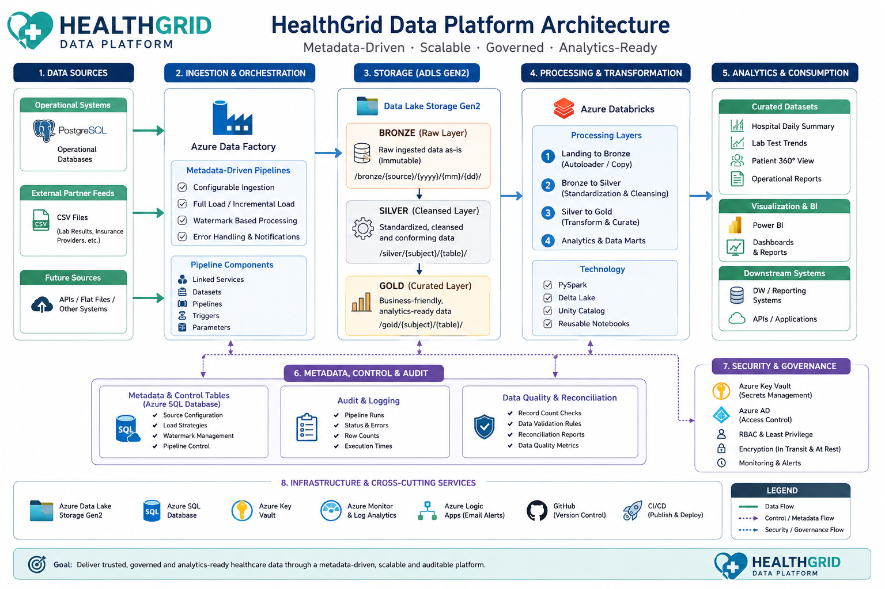

# HealthGrid — Metadata-Driven Healthcare Data Platform

**An Azure-based, metadata-driven data platform for integrating simulated healthcare operations and partner feeds into governed, analytics-ready datasets.**

**Stack:** PostgreSQL, Azure SQL Database, Azure Data Factory, ADLS Gen2, Azure Databricks, Apache Spark / PySpark, Delta Lake, Unity Catalog, SQL, GitHub Actions.

> **Execution status — completed:** Successfully deployed and executed end to end in the original Azure environment. Cloud resources were later decommissioned to control ongoing costs; the repository preserves the implementation, deployment assets, synthetic source data, mapping workbook and architecture diagram.

HealthGrid models a multi-site healthcare network with PostgreSQL operational tables and external CSV partner feeds. Azure Data Factory orchestrates ingestion and processing, Azure Data Lake Storage Gen2 provides the landing layer, and Azure Databricks transforms the data through Bronze, Silver, and Gold layers. The design emphasizes reusable metadata-driven execution, incremental processing, replay controls, auditability, and business-oriented analytical models.

> **Synthetic-data and intended-use notice:** All patient, clinician, hospital, laboratory-event, and insurance-provider records in this repository are synthetic. Provider names are fictional demo entities, and contact addresses use placeholder `.example` domains. No real patient records, provider relationships, or live clinical integrations are represented. HealthGrid demonstrates data engineering and operational analytics patterns; it is not a clinical product and must not be used to diagnose, treat, triage, or make patient-care decisions.

The platform was originally developed under the name **CareSync** and later renamed **HealthGrid**. CareSync is retained here only as project history; the committed ADF, Databricks, and deployment artifacts now use HealthGrid naming conventions.

## Platform at a glance

| Area | Implementation |
|---|---|
| Business domain | Simulated multi-site healthcare administration and partner feeds |
| Operational source | PostgreSQL hospital, clinician and patient tables |
| Partner data | Laboratory-result and insurance-provider CSV feeds |
| Control plane | Azure SQL metadata, watermark, file-manifest and audit tables |
| Orchestration | Azure Data Factory master and child pipelines |
| Landing and storage | Azure Data Lake Storage Gen2 |
| Processing | Azure Databricks, PySpark and Delta Lake |
| Load strategies | FULL, APPEND and version-aware MERGE |
| Analytical outputs | Patient 360, hospital daily summary and lab-test trends |
| Governance | Unity Catalog and environment-specific deployment configuration |

## Business problem

A multi-site healthcare network may need to consolidate administrative data from operational systems with laboratory and insurance-reference feeds delivered by external partners. The sources have different structures, delivery patterns, and update semantics. A robust platform must do more than copy data: it must select work from metadata, preserve batch lineage, handle incremental changes and file re-delivery, expose execution state, and prevent failed upstream processing from being presented as successful analytics.

HealthGrid demonstrates this engineering response through a shared metadata framework, Azure Data Factory orchestration, controlled Bronze/Silver processing, version-aware MERGE behavior, file-manifest replay protection, audit records, and curated Gold datasets.

The business scenario is intentionally simulated. The project evaluates the data platform and analytical modelling patterns—not clinical workflows or medical outcomes.

## Architecture

The architecture diagram above is the original project diagram and is intentionally retained unchanged.

### End-to-end data flow

1. **Sources**
   - PostgreSQL hospital operational data: hospitals, doctors, and patients.
   - Partner CSV feeds: laboratory results and insurance providers.
2. **Metadata and orchestration**
   - Azure SQL Database stores source configuration, load strategies, watermarks, and audit records.
   - Azure Data Factory reads active configuration and orchestrates source-to-Silver and Silver-to-Gold processing.
   - The master pipeline waits for both source branches, gates Gold on both succeeding, and sends a run notification after the Gold decision—including source-failure paths.
3. **Landing and storage**
   - Azure Data Lake Storage Gen2 receives source extracts and partner files.
   - Databricks landing processing reads each timestamped landing batch and appends it to the corresponding Bronze table.
4. **Transformation**
   - Azure Databricks and Apache Spark process the timestamped Bronze batch into Silver tables.
   - Configured load strategies determine whether a Silver target is overwritten, appended to, or merged using configured business keys.
   - A calendar dimension supports date-based analytical enrichment.
5. **Analytics**
   - Databricks SQL notebooks build the Gold patient, hospital, and laboratory datasets for downstream reporting and analysis.

## Architecture-to-code map

Use this map to move from the architecture diagram to the implementation that realizes each part of the platform.

| Architecture concern | Implementation evidence | What to inspect |
|---|---|---|
| End-to-end orchestration | [Master pipeline](<04_Azure Data Factory Repository/pipeline/PL_MASTER.json>) and [source-to-Silver dispatcher](<04_Azure Data Factory Repository/pipeline/PL_SOURCE_TO_SILVER_MAIN.json>) | Separate PostgreSQL and CSV ingestion branches, pipeline dependencies, and the hand-off to Gold processing |
| Metadata-driven source ingestion | [Source-to-Silver inner pipeline](<04_Azure Data Factory Repository/pipeline/PL_SOURCE_TO_SILVER_INNER.json>) and [control-table DDL/seeds](<02_Metadata Table Queries/create_control_tables.sql>) | Runtime configuration lookup, source selection, configured load strategies, watermark handling, and audit lifecycle |
| Metadata-driven Gold orchestration | [Silver-to-Gold pipeline](<04_Azure Data Factory Repository/pipeline/PL_SILVER_TO_GOLD.json>) | Active `SILVER_TO_GOLD` metadata selection and dynamic notebook dispatch using `gold_table_name` |
| Landing and Bronze processing | [Landing-to-Bronze notebook](<05_Databricks_Repository/Landing_to_Bronze.ipynb>) | Timestamped landing-batch reads, ingestion metadata, and Bronze Delta writes |
| Reusable Silver processing | [Bronze-to-Silver notebook](<05_Databricks_Repository/Bronze_to_Silver.ipynb>) | Shared FULL, APPEND, and version-aware MERGE processing, including key and source-version validation |
| Curated Gold analytics | [Patient 360](<05_Databricks_Repository/Gold/NB_patient_360.py>), [hospital daily summary](<05_Databricks_Repository/Gold/NB_hospital_daily_summary.py>), and [lab test trends](<05_Databricks_Repository/Gold/NB_lab_test_trends.py>) | Dataset-specific analytical transformations and output grain |
| File replay and incremental controls | [Control metadata DDL](<02_Metadata Table Queries/create_control_tables.sql>), [file-manifest design](docs/FILE_INGESTION_MANIFEST.md), [watermark lookback migration](<02_Metadata Table Queries/add_watermark_lookback.sql>), and [patient timestamp-trigger migration](<01_Sources Data/01_postgres/install_patients_updated_at_trigger.sql>) | Per-file replay identity, processing states, bounded timestamp overlap, and source timestamp maintenance |
| Validation and operational readiness | [Repository CI workflow](.github/workflows/healthgrid-validation.yml), [validation plan](docs/VALIDATION_PLAN.md), and [operations runbook](docs/OPERATIONS_RUNBOOK.md) | Static repository contracts, deferred cloud-runtime tests, monitoring, recovery, and operational checks |

The code map complements the architecture image; it does not replace or modify the original diagram.

## Technology stack

| Area | Technologies |
|---|---|
| Cloud platform | Microsoft Azure |
| Orchestration | Azure Data Factory |
| Data lake | Azure Data Lake Storage Gen2 |
| Operational source | PostgreSQL |
| Control database | Azure SQL Database |
| Data processing | Azure Databricks, Apache Spark, PySpark |
| Transformation language | Spark SQL |
| Secrets integration | Azure Key Vault-linked configuration |
| Source formats | PostgreSQL tables, CSV |
| Data architecture | Bronze, Silver, Gold medallion layers |
| Automation assets | Azure Data Factory JSON exports and Databricks notebooks |

## Design decisions and trade-offs

| Decision | Why it is used | Trade-off / boundary |
|---|---|---|
| Metadata-driven orchestration | ADF reads source, target, load-strategy and active-state configuration instead of duplicating a pipeline for every entity | Metadata contracts must be validated; the configured table and notebook references remain environment-specific |
| Separate source branches | PostgreSQL and partner CSV feeds use distinct ingestion paths under a shared master workflow | Each source type needs its own cursor, retry and duplicate-handling semantics |
| File-ingestion manifest for CSV | Tracks individual file versions and protects against replay of the same delivered file | Re-delivered or revised whole-file snapshots still need a clear business-level duplicate policy |
| Timestamp watermarks for PostgreSQL | Provides bounded incremental extraction without introducing a separate CDC service | Watermarks are not CDC and can miss hard deletes and sufficiently late/backdated updates |
| Gold full refresh | Rebuilds the curated analytical outputs from Silver in a predictable, auditable step | Compute grows with the Silver history; incremental Gold materialization would need separate change-impact logic |

The detailed rationale and implementation contracts are recorded in [Engineering Decisions](docs/ENGINEERING_DECISIONS.md).

## Source systems and ingestion strategy

The control metadata seeds five source objects:

| Source | Object | Configured load strategy | Purpose |
|---|---|---|---|
| PostgreSQL | `hospitals` | FULL | Hospital and facility reference data |
| PostgreSQL | `doctors` | FULL | Physician roster and hospital association |
| PostgreSQL | `patients` | MERGE | Patient registration and demographic updates |
| ADLS CSV | `lab_results` | APPEND | External laboratory result feed |
| ADLS CSV | `insurance_providers` | FULL | Insurance provider reference data |

The source-to-Silver framework uses `ctrl.table_config` to select active source objects and their configured load strategy. PostgreSQL timestamp-incremental extraction uses `ctrl.watermark`. ADLS CSV ingestion uses `ctrl.file_ingestion_manifest`, which identifies individual file versions and tracks them through copy and Bronze-to-Silver processing. The ADF pipeline records execution status and row counts in `ctrl.audit_log`.

The PostgreSQL watermark approach is not a substitute for CDC: its correctness depends on source timestamps being maintained reliably and on the chosen watermark semantics being appropriate for the source. CSV selection is based on file metadata, not the `reported_at` business event-time column.

For the PostgreSQL `patients` MERGE source, metadata configures a five-minute lookback. ADF captures a fixed UTC upper bound at run start and extracts the interval from the inclusive previous-checkpoint-minus-lookback boundary to that exclusive upper bound. The checkpoint advances to the captured run-start bound only after Bronze-to-Silver succeeds, and the update is monotonic so an older overlapping run cannot move it backwards. The overlap is replay-safe because Silver uses the version-aware `patient_id` MERGE. The supplied PostgreSQL source DDL also installs a `BEFORE UPDATE` trigger that refreshes `patients.updated_at` in UTC even when an individual update statement omits the field.

## Medallion data layers

### Bronze — landed source batches

The Landing-to-Bronze notebook validates its source/table/batch parameters and file format, reads CSV or Parquet files from the timestamped landing path, and appends the batch to Bronze with `landing_timestamp` and `insert_timestamp`. It rejects invalid or missing load metadata instead of assuming FULL, rejects empty FULL extracts, blocks source columns that collide with reserved batch metadata, fails closed on case-insensitive schema drift or data-type changes, and prevents a landing timestamp already present in Bronze from being appended again. This protects batch traceability and exact-batch replay; it does not deduplicate the same business rows arriving under a different landing timestamp.

### Silver — standardized source tables

The shared Bronze-to-Silver notebook reads only the Bronze records for the current ADF landing timestamp and applies the configured strategy:

| Strategy | Behavior | Safety boundary |
|---|---|---|
| **FULL** | Replaces the Silver target with the current complete batch. | Missing/invalid load metadata is rejected rather than defaulting to FULL. A FULL batch must contain data; Landing-to-Bronze rejects an empty FULL extract before Silver can be overwritten. |
| **APPEND** | Adds the current batch to the Silver target. | It does not deduplicate business records across different landing timestamps. Exact CSV file versions are guarded by the file manifest, but revised whole-file snapshots or a newly identified batch containing prior events can still duplicate rows. |
| **MERGE** | Inserts new keys and updates existing keys only when the incoming source version is newer. | Requires non-null, unique source keys and non-null DATE/TIMESTAMP versions; validates target keys, schema names and data types before mutation. |

For MERGE, the shared notebook rejects duplicate source keys rather than selecting an arbitrary winner. Existing target keys must also be non-null and unique. Older source versions are skipped; an equal-version identical payload is a no-op; an equal-version payload conflict fails for reconciliation. Operational batch timestamps are excluded from the equal-version business-payload comparison.

The notebook also validates its ADF hand-off: it accepts only DATA or NO_DATA status, restricts table and batch identifiers to safe formats, rejects an unexpected empty Bronze batch reported as DATA, and never assumes FULL when load metadata is missing or invalid. The repository CI workflow checks these static contracts and notebook Python syntax. Spark/Delta behavior still requires runtime tests in a restored Databricks environment.

A calendar dimension is also prepared in Silver to support date-based reporting.

### Gold — analytical datasets

Three Gold notebooks create curated datasets from the Silver layer. The target tables are rebuilt with CREATE OR REPLACE TABLE; they are full refreshes, not incremental Gold merges.

| Gold dataset | Grain | Transformations and metric definitions |
|---|---|---|
| [patient_360](<05_Databricks_Repository/Gold/NB_patient_360.py>) | One row per patient_id | Preserves patient records with left joins to hospital and provider references; aggregates lab events per patient before joining; exposes total, abnormal and critical test counts plus last test date. Age is calculated at rebuild time using an approximate 365.25-day year. |
| [hospital_daily_summary](<05_Databricks_Repository/Gold/NB_hospital_daily_summary.py>) | One row per hospital_id, summary_date | Aggregates test volume, distinct patients and doctors represented in test activity, result-status counts and rates; adds calendar attributes and a comparison with the previous available date row for that hospital. |
| [lab_test_trends](<05_Databricks_Repository/Gold/NB_lab_test_trends.py>) | One row per test_name, year, month | Aggregates monthly test volume, abnormal and critical counts and rates; calculates the change in abnormal rate versus the previous available month for that test. |

**Metric interpretation matters:** hospital daily and lab monthly LAG calculations compare with the previous available observation, not a generated zero-activity calendar day/month. test_volume_change_pct is relative percentage change; abnormal_rate_change_pct is a percentage-point difference between two rates. The hospital active_doctor_count counts distinct doctors represented in test events, not the full doctor roster.

Before each `CREATE OR REPLACE TABLE`, the Gold notebooks run input preflight checks: laboratory event IDs must be non-null and unique; the dimensions used by joins must have unique keys; non-null patient, hospital, doctor, and provider references must resolve; modeled event dates, test names, and result-status values must be valid; and the applicable calendar must cover every event date/month. After materialization, each notebook checks required output columns, non-null and unique grain keys, and count/rate bounds before returning its row count. This is especially important because the laboratory source uses APPEND: a repeated business event delivered in a different file batch can bypass exact file-version replay protection. Gold now fails closed on duplicate event IDs rather than automatically deduplicating Silver; the duplicate must be reconciled in Silver before retrying the rebuild. These are notebook runtime checks; they have not been executed against a restored Azure/Databricks environment after the environment was decommissioned. The repository CI workflow checks source syntax and static contracts, not Spark query results.

These models illustrate the kinds of operational questions a data team could support:

| Operational question | Gold output | Analytical purpose |
|---|---|---|
| What is the consolidated administrative and laboratory-activity view for a synthetic patient record? | patient_360 | Combines registration, facility, insurer-reference, and pre-aggregated laboratory activity at patient grain |
| How does laboratory activity vary across facilities and days? | hospital_daily_summary | Compares test volumes, unique patients, doctors represented in test activity, and result-status mix |
| Which test categories are increasing or changing in outcome mix over time? | lab_test_trends | Tracks monthly test volumes and the distribution of synthetic result-status categories |

The Abnormal and Critical labels are supplied by the synthetic source fixtures. They are treated as reporting categories only; the platform does not calculate clinical thresholds, diagnose conditions, or recommend treatment.

**All layers are metadata-driven.** Active metadata configures source-to-Silver processing and selects the Gold outputs to execute. The Gold pipeline reads active SILVER_TO_GOLD records from ctrl.table_config and resolves each Databricks notebook path from gold_table_name. Dataset-specific analytical transformation logic remains implemented in the corresponding notebooks.

## Orchestration and operational controls

The exported Azure Data Factory assets include a master pipeline and child pipelines for source-to-Silver ingestion, Silver-to-Gold processing, and status notification.

The control framework includes:

- Active/inactive source configuration.
- Source object, file format, path, target table, load type, watermark column, and merge-key metadata.
- Timestamp watermark state for PostgreSQL incremental sources.
- `ctrl.file_ingestion_manifest` for ADLS CSV file-version identity and replay control.
- Audit records with ADF run ID, processing stage, status, row count, and timestamps; uniqueness is enforced per parent run/table/stage, with idempotent retry upserts.
- Per-file CSV states: IN_PROGRESS, COPIED, PROCESSED, and FAILED; file versions are finalized only after Bronze-to-Silver succeeds.
- Success/failure status updates around notebook execution.
- A notification pipeline that assembles run status information for a Logic Apps endpoint.

**Orchestration gate:** the master waits for both source branches to reach `Completed`, evaluates their actual `.Status` values, and invokes Silver-to-Gold only when both source branches have `Succeeded`. The notification pipeline runs after the Gold decision completes, including when a source failure causes Gold to be skipped. Its request carries the parent `adf_run_id`, three parent branch outcomes, and the ordered table-level audit rows. The [notification payload contract](docs/NOTIFICATION_CONTRACT.md) documents the producer schema and the external Logic Apps validation boundary. The CSV manifest blocks automatic recopy of file versions left in an unresolved prior-run state.

## Repository guide

| Path | Contents |
|---|---|
| [PostgreSQL source scripts](<01_Sources%20Data/01_postgres/>) | Non-destructive fresh initialization, explicitly gated source reset, seed data, incremental changes, and patient timestamp-trigger migration |
| [ADLS CSV source data](<01_Sources%20Data/02_adls_csv/>) | Initial and incremental partner feed samples |
| [Control metadata SQL](<02_Metadata%20Table%20Queries/>) | Fresh control initialization, explicitly gated reset, PostgreSQL watermark/lookback migration, CSV file manifest, and audit-key migration |
| [Gold STTM workbook](<03_Gold%20STTM/sttm_silver_to_gold.xlsx>) | Source-to-target mapping for analytical outputs |
| [Azure Data Factory exports](<04_Azure%20Data%20Factory%20Repository/>) | Factory, linked services, datasets, and pipeline JSON |
| [Databricks notebooks](<05_Databricks_Repository/>) | Landing, Bronze-to-Silver, calendar, and Gold transformations |
| [Architecture diagram](assets/architecture-overview.png) | Original HealthGrid architecture image |

## Engineering and operations documentation

| Document | Purpose |
|---|---|
| [Engineering decisions](docs/ENGINEERING_DECISIONS.md) | Architecture choices, metadata-driven design, trade-offs, and implementation boundaries |
| [Data dictionary](docs/DATA_DICTIONARY.md) | Source entities, control tables, layer responsibilities, and Gold dataset grain |
| [Operations runbook](docs/OPERATIONS_RUNBOOK.md) | Monitoring, audit interpretation, checkpoint operations, troubleshooting, and recovery |
| [Validation plan](docs/VALIDATION_PLAN.md) | Repeatable tests, measurable acceptance criteria, and release gates |
| [Deployment guide](docs/DEPLOYMENT.md) | Environment setup, secure configuration, deployment sequence, and cleanup |
| [Artifact audit](docs/ARTIFACT_AUDIT.md) | Repository inventory, artifact coverage, security findings, and known limitations |
| [Senior engineering readiness review](docs/SENIOR_ENGINEERING_READINESS.md) | Evidence-based assessment, capability ratings, and remaining engineering maturity gaps |
| [CSV file ingestion manifest](docs/FILE_INGESTION_MANIFEST.md) | Per-file identity, manifest states, replay protection, and recovery procedure |
| [Source fixture contract](docs/SOURCE_FIXTURE_CONTRACT.md) | PostgreSQL fixture execution order, one-time update guards, CSV snapshot/additive semantics, and expected counts |
| [ADF source extraction contract](docs/ADF_SOURCE_EXTRACTION_CONTRACT.md) | Metadata validation, PostgreSQL identifier quoting, watermark boundaries, checkpoint behaviour, and landing hand-off |
| [Notification payload contract](docs/NOTIFICATION_CONTRACT.md) | ADF-to-Logic Apps request fields, status semantics, and external consumer validation |

## Repository validation

The repository has two deliberately separate GitHub Actions workflows:

- [Repository validation](.github/workflows/healthgrid-validation.yml) runs on relevant pushes and pull requests. It validates exported JSON, Databricks notebook code-cell syntax, Python syntax, repository contracts, required documentation, the preserved architecture-image embed, and selected credential patterns. Its path filters include SQL, CSV, workbook, and architecture assets.
- [Azure integration validation](.github/workflows/healthgrid-azure-integration.yml) is manually triggered and gated by a GitHub Environment. When a disposable DEV environment and GitHub OIDC configuration are available, it starts the ADF `PL_MASTER` pipeline and monitors the run to completion. ADF then invokes the configured Databricks notebook activities.

The repository-validation workflow is static by design; it does not start cloud services or incur Azure compute costs. The integration workflow is not run on every commit and remains unavailable until its Azure resources, identity federation, environment secrets, and variables are configured. A successful master run is one end-to-end signal, not a substitute for the scenario-level data reconciliation and failure-injection tests in [the validation plan](docs/VALIDATION_PLAN.md).

## Running and redeploying the project

The project was executed successfully end-to-end in its original Azure environment. That environment and its resource identifiers may differ from a future HealthGrid deployment.

A redeployment should follow this high-level sequence:

1. Provision the PostgreSQL source, Azure SQL control database, ADLS Gen2 storage, Azure Databricks workspace, and Azure Data Factory.
2. Configure linked services and credentials through secure deployment configuration and Azure Key Vault.
3. Create the source tables and load the supplied synthetic source data.
4. Create and seed the control metadata tables, including the file-ingestion manifest.
5. Create the `healthgrid` Unity Catalog catalog with the required `landing`, `bronze`, `silver`, and `gold` schemas, create the landing Volume, import notebooks under `/Shared/HealthGrid/`, and configure the target environment's Azure endpoints and compute references.
6. Publish the ADF factory and pipeline assets.
7. Run the master pipeline and verify the source-to-Silver and Silver-to-Gold audit records.
8. Reconcile source, Bronze, Silver, and Gold record counts and inspect the resulting analytical tables.

Source initialization and destructive reset are separate operations. `create_source_tables.sql` creates and seeds the three PostgreSQL tables only when none of them exists; it refuses to run over existing data. An intentional disposable-environment reset requires the separate `reset_source_tables.sql` script and the explicit same-session setting documented in that file. Azure SQL control-table creation follows the same fresh-initialization-only rule; `drop_control_tables.sql` requires a separate session-context authorization and deletes metadata, checkpoints, audit history, and file replay state. Review [the deployment guide](docs/DEPLOYMENT.md) before running either reset.

The repository uses the `healthgrid` catalog and `/Volumes/healthgrid/landing/landing_volume` for Databricks storage. ADF notebook activities point to `/Shared/HealthGrid/`; import the notebooks at those workspace paths or update the ADF references consistently. Linked-service exports use explicit placeholders for the target Key Vault, ADLS account, Azure SQL server/database/user, Databricks workspace, and cluster. Replace these placeholders before publishing. Credentials continue to be resolved through Key Vault references.

## Data handling and project scope

HealthGrid is a portfolio/reference implementation built with synthetic source records and fictionalized partner-provider names. It contains no real patient information and has no live clinical-system integration. The analytical outputs are designed to demonstrate operational reporting and data-modelling techniques only; they are not intended for diagnosis, triage, treatment, or other patient-care decisions.

A production adaptation would require a separately designed security and privacy architecture, lawful data access, identity and access controls, encryption, retention policies, lineage and audit controls, data-quality ownership, clinical governance where applicable, and jurisdiction-specific regulatory review. Those production controls are not implied by this demonstration.

## Engineering scope and known considerations

- Source-to-Silver ingestion is metadata-configured; ADLS CSV uses a per-file manifest, while PostgreSQL incremental extraction uses timestamp watermarks. Gold transformation SQL is defined in the individual notebooks.
- Timestamp watermarks are not CDC: hard deletes are not captured, source updates older than the configured five-minute lookback can still be missed, and `updated_at` must be maintained reliably in UTC. Revalidate late-arrival, concurrency, and timestamp-boundary behavior in a restored Azure environment.
- The MERGE strategy depends on correctly configured business keys and appropriate source deduplication.
- The master pipeline gates Gold on successful source branches; its notification branch runs after Gold completes.
- Source/control initialization is non-destructive and refuses existing control objects; destructive resets are separate, explicitly gated scripts intended only for disposable environments.
- Environment-specific catalog, workspace, notebook, storage, and integration references must be parameterized or updated during redeployment.

These considerations are documented to make the implementation and its operational boundaries clear; they do not change the fact that the project was successfully run in its original environment.

## Project status

**Completed end to end — successfully executed in Azure.** The platform was deployed and run successfully in its original Azure environment. Cloud resources were later decommissioned to control ongoing costs; the repository retains the source scripts, orchestration exports, notebooks, sample data, mapping workbook and original architecture diagram. GitHub Actions run [#289](https://github.com/viradidi/healthgrid-data-platform/actions/runs/41712998524) completed successfully on 3 November 2026, validating 18 JSON files, 3 notebooks, 3 Python files and repository contracts. That workflow is static validation; it does not execute ADF, Spark/Delta transformations or the external Logic Apps consumer. See the [senior engineering readiness review](docs/SENIOR_ENGINEERING_READINESS.md) for technical boundaries and future hardening considerations.
