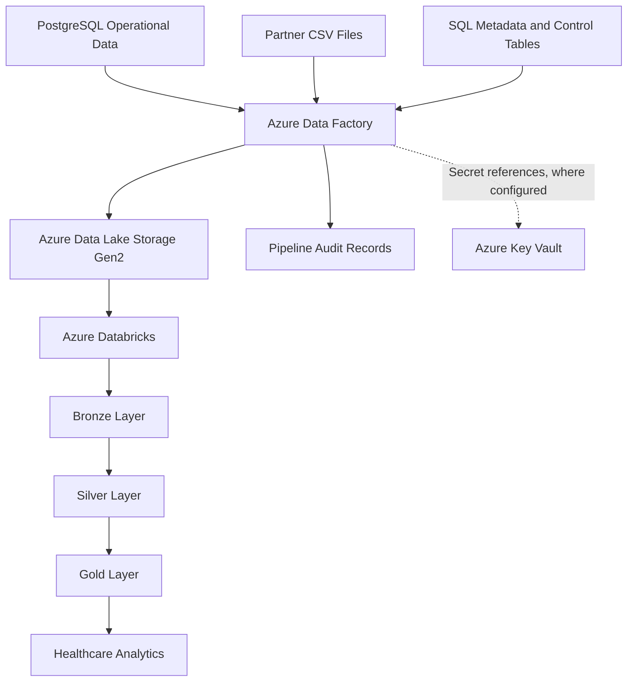

# HealthGrid — Metadata-Driven Healthcare Data Platform

**Building a reliable, auditable data foundation for connected healthcare systems.**

HealthGrid is a fictional healthcare data engineering project built around Microsoft Azure and Azure Databricks. It demonstrates how relational operational data and external partner files can be ingested, standardized, governed, and prepared for analytical consumption.

The platform is designed around metadata-driven ingestion, incremental processing, medallion architecture, pipeline auditing, and reusable data integration patterns.

> **Project context:** This project uses fictional healthcare scenarios and synthetic sample data for educational and portfolio purposes. It is intended to demonstrate data engineering architecture and implementation practices, not to provide a production-ready clinical system.

## Business Problem

Healthcare networks may receive operational data from multiple disconnected systems, including relational databases and external laboratory or insurance partners.

Without a consistent integration approach, engineering teams can face:

- Repeated pipeline development for individual data sources.
- Inconsistent data structures and transformation rules.
- Inefficient processing of previously ingested records.
- Limited visibility into pipeline execution and failures.
- Difficulty tracing source records through downstream transformations.
- Inconsistent analytical datasets for operational reporting.

HealthGrid explores how a configurable ingestion framework and layered data architecture can address these challenges.

## Solution Overview

The platform organizes ingestion, storage, transformation, and operational control into reusable components.

- **Metadata-driven ingestion:** SQL control tables and Azure Data Factory configurations support configurable source processing.
- **Incremental processing:** Source scripts and pipeline configurations implement loading patterns that should be validated against their intended watermark and change-detection rules.
- **Medallion architecture:** Bronze, Silver, and Gold layers separate ingestion, standardization, and analytical preparation.
- **Operational auditing:** Metadata and audit-table scripts provide a foundation for tracking pipeline execution.
- **Analytics-ready data:** Gold-layer transformation notebooks prepare datasets for healthcare reporting and trend analysis.
- **Maintainable delivery:** SQL scripts, notebooks, pipeline JSON, and documentation are version-controlled in Git.

## Architecture

*Architecture overview: conceptual representation of the intended data flow. Confirm individual connections and deployed services against the actual Azure configuration before treating this diagram as deployment evidence.*

### Architecture Components

| Component | Responsibility |
|---|---|
| PostgreSQL | Relational source data |
| Partner CSV files | External sample data feeds |
| Azure Data Factory | Pipeline orchestration and source integration |
| SQL metadata and control tables | Configurable ingestion and execution-control metadata |
| Azure Data Lake Storage Gen2 | Data lake storage |
| Azure Databricks | Distributed data transformation using Spark and PySpark |
| Bronze layer | Ingested source data |
| Silver layer | Standardized and transformed data |
| Gold layer | Curated analytical datasets |
| Audit records | Pipeline execution tracking |
| Azure Key Vault | Intended secret-management integration, subject to configuration validation |

## Technology Stack

**Cloud and orchestration**
- Microsoft Azure
- Azure Data Factory
- Azure Data Lake Storage Gen2
- Azure SQL Database
- Azure Key Vault
- Azure Logic Apps

**Data engineering**
- Azure Databricks
- Apache Spark and PySpark
- Delta Lake
- PostgreSQL
- SQL

**Data architecture and delivery**
- Medallion architecture
- Metadata-driven ingestion
- Incremental data processing
- Pipeline auditing
- Git and GitHub

The repository contains configurations and artifacts associated with these technologies. Actual deployment and successful execution should be established separately.

## Repository Structure

| Directory | Contents |
|---|---|
| `01_Sources Data/` | Sample CSV files and PostgreSQL source scripts |
| `02_Metadata Table Queries/` | Control-table, metadata, and audit SQL scripts |
| `03_Gold STTM/` | Source-to-target mapping documentation |
| `04_Azure Data Factory Repository/` | Factory, dataset, linked-service, and pipeline JSON |
| `05_Databricks_Repository/` | Ingestion, transformation, calendar, and Gold-layer notebooks |
| `assets/` | Architecture and supporting project images |

## Engineering Focus

HealthGrid provides a foundation for exploring the operational challenges of maintaining reliable data pipelines.

Key validation areas include:

- **Incremental correctness:** Determine whether new and updated records are captured without unintended omissions.
- **Idempotency:** Test whether rerunning a pipeline produces consistent results without duplicating data.
- **Watermark management:** Verify when processing checkpoints advance and how failed runs affect subsequent executions.
- **Data quality:** Validate required fields, key uniqueness, data types, referential integrity, and business rules.
- **Reconciliation:** Compare source and destination record counts and relevant business totals.
- **Failure recovery:** Examine retry behavior, partial loads, and restart procedures.
- **Auditability:** Confirm that execution status, timestamps, row counts, and errors can be traced where required.
- **Security:** Validate identity permissions, secret references, and access boundaries.
- **Maintainability:** Review reusable pipeline patterns, configuration, documentation, and version control.

These are engineering validation objectives, not claims that every scenario has already been implemented or tested.

## Analytical Use Cases

The repository includes Gold-layer notebook artifacts for:

- Hospital daily summaries.
- Laboratory test trends.
- Patient-level analytical views.

These use cases illustrate how transformed healthcare data can support operational analysis. Their outputs, business definitions, and data-quality assumptions should be verified before publishing screenshots or quantitative results.

## Validation and Deployment

The repository contains SQL scripts, Azure Data Factory JSON configurations, and Databricks notebooks. Before describing the platform as production-ready, validate the following:

1. Source-to-target data movement.
2. Full and incremental loading behavior.
3. Watermark persistence and recovery after failures.
4. Bronze-to-Silver and Silver-to-Gold transformation results.
5. Automated data-quality and reconciliation tests.
6. Audit records for successful and failed executions.
7. Secret management and least-privilege access.
8. Deployment instructions and reproducibility in a clean environment.

No production deployment, performance benchmark, or successful end-to-end run should be inferred from repository files alone.

## Project Context and Attribution

**Repository maintainer:** Isaiah Nyakundi (`viradidi`).

HealthGrid is presented as an educational data engineering project using fictional healthcare scenarios and synthetic sample data. The repository is maintained as part of my data engineering portfolio. Where source material, teaching materials, or contributions from others are reused, applicable permissions and attribution requirements should be respected.

## Further Documentation

Supporting documentation can be expanded to cover:

- Detailed architecture and component responsibilities.
- Source-to-target mappings and data models.
- Ingestion and watermark design.
- Data-quality and reconciliation results.
- Security and identity decisions.
- Deployment and recovery procedures.
- Automated testing and operational evidence.

## Repository

[View the HealthGrid Data Platform on GitHub](https://github.com/viradidi/healthgrid-data-platform)