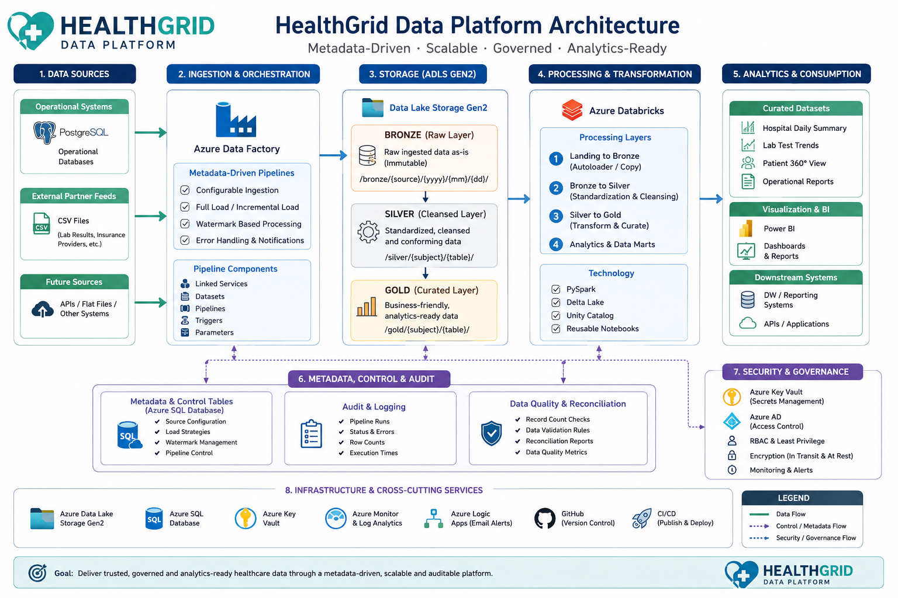

# HealthGrid — Metadata-Driven Healthcare Data Platform

**An end-to-end Azure data engineering platform for integrating healthcare operational data and partner feeds into analytics-ready datasets.**

HealthGrid is an educational data engineering project built with synthetic healthcare data. It demonstrates how a healthcare network can ingest relational operational data and external partner files, manage ingestion through metadata and audit controls, process data through a Bronze/Silver/Gold architecture, and publish curated analytical outputs.

The platform was originally developed under the name **CareSync** and was later renamed **HealthGrid**. Some exported Azure and Databricks artifacts still contain legacy CareSync resource, catalog, or workspace identifiers. These are deployment references—not a different project—and should be aligned with the target environment when provisioning a newly named deployment.

## Business problem

Healthcare networks commonly bring together information from internal hospital systems and external partners. These sources can differ in structure, delivery format, and update frequency. Without reusable ingestion patterns and operational controls, pipelines can become difficult to maintain, monitor, and extend.

HealthGrid addresses this integration challenge with configurable source ingestion, centralized control metadata, auditable pipeline execution, layered transformations, and business-oriented Gold datasets.

## Architecture

The architecture diagram above is the original project diagram and is intentionally retained unchanged.

### End-to-end data flow

1. **Sources**
   - PostgreSQL hospital operational data: hospitals, doctors, and patients.
   - Partner CSV feeds: laboratory results and insurance providers.
2. **Metadata and orchestration**
   - Azure SQL Database stores source configuration, load strategies, watermarks, and audit records.
   - Azure Data Factory reads active configuration and orchestrates source-to-Silver and Silver-to-Gold processing.
3. **Landing and storage**
   - Azure Data Lake Storage Gen2 receives source extracts and partner files.
   - Databricks landing processing reads each timestamped landing batch and appends it to the corresponding Bronze table.
4. **Transformation**
   - Azure Databricks and Apache Spark process the timestamped Bronze batch into Silver tables.
   - Configured load strategies determine whether a Silver target is overwritten, appended to, or merged using configured business keys.
   - A calendar dimension supports date-based analytical enrichment.
5. **Analytics**
   - Databricks SQL notebooks build the Gold patient, hospital, and laboratory datasets for downstream reporting and analysis.

## Technology stack

| Area | Technologies |
|---|---|
| Cloud platform | Microsoft Azure |
| Orchestration | Azure Data Factory |
| Data lake | Azure Data Lake Storage Gen2 |
| Operational source | PostgreSQL |
| Control database | Azure SQL Database |
| Data processing | Azure Databricks, Apache Spark, PySpark |
| Transformation language | Spark SQL |
| Secrets integration | Azure Key Vault-linked configuration |
| Source formats | PostgreSQL tables, CSV |
| Data architecture | Bronze, Silver, Gold medallion layers |
| Automation assets | Azure Data Factory JSON exports and Databricks notebooks |

## Source systems and ingestion strategy

The control metadata seeds five source objects:

| Source | Object | Configured load strategy | Purpose |
|---|---|---|---|
| PostgreSQL | `hospitals` | FULL | Hospital and facility reference data |
| PostgreSQL | `doctors` | FULL | Physician roster and hospital association |
| PostgreSQL | `patients` | MERGE | Patient registration and demographic updates |
| ADLS CSV | `lab_results` | APPEND | External laboratory result feed |
| ADLS CSV | `insurance_providers` | FULL | Insurance provider reference data |

The source-to-Silver framework uses `ctrl.table_config` to select active source objects and their configured load strategy. PostgreSQL timestamp-incremental extraction uses `ctrl.watermark`. ADLS CSV ingestion uses `ctrl.file_ingestion_manifest`, which identifies individual file versions and tracks them through copy and Bronze-to-Silver processing. The ADF pipeline records execution status and row counts in `ctrl.audit_log`.

The PostgreSQL watermark approach is not a substitute for CDC: its correctness depends on source timestamps being maintained reliably and on the chosen watermark semantics being appropriate for the source. CSV selection is based on file metadata, not the `reported_at` business event-time column.

## Medallion data layers

### Bronze — landed source batches

The Landing-to-Bronze notebook reads CSV or Parquet files from the timestamped landing path, adds landing and ingestion timestamps, and appends the batch to the corresponding Bronze table. This preserves the ingested batch context for subsequent processing.

### Silver — standardized source tables

The Bronze-to-Silver notebook processes the Bronze records for the current landing timestamp. It supports three configured write strategies:

- **FULL:** overwrite the Silver target with the current processed batch.
- **APPEND:** append the current batch to the Silver target.
- **MERGE:** match configured business keys and update matched rows or insert new rows.

The framework validates that merge keys are provided and exist in the incoming data before executing a MERGE.

A calendar dimension is also prepared in Silver to support date-based reporting.

### Gold — analytical datasets

Three Gold notebooks create curated datasets from the Silver layer:

| Gold dataset | Analytical purpose |
|---|---|
| `patient_360` | Patient-level view enriched with hospital, insurance provider, and aggregated laboratory activity |
| `hospital_daily_summary` | Daily hospital laboratory volumes, unique patients, doctor counts, abnormal and critical results, and trend measures |
| `lab_test_trends` | Monthly laboratory test volumes, abnormal and critical counts, rates, and month-over-month changes |

**All layers are metadata-driven.** Active metadata configures source-to-Silver processing and selects the Gold outputs to execute. The Gold pipeline reads active `SILVER_TO_GOLD` records from `ctrl.table_config` and resolves each Databricks notebook path from `gold_table_name`. Dataset-specific analytical transformation logic remains implemented in the corresponding notebooks.

## Orchestration and operational controls

The exported Azure Data Factory assets include a master pipeline and child pipelines for source-to-Silver ingestion, Silver-to-Gold processing, and status notification.

The control framework includes:

- Active/inactive source configuration.
- Source object, file format, path, target table, load type, watermark column, and merge-key metadata.
- Timestamp watermark state for PostgreSQL incremental sources.
- `ctrl.file_ingestion_manifest` for ADLS CSV file-version identity and replay control.
- Audit records with ADF run ID, processing stage, status, row count, and timestamps.
- Per-file CSV states: IN_PROGRESS, COPIED, PROCESSED, and FAILED; file versions are finalized only after Bronze-to-Silver succeeds.
- Success/failure status updates around notebook execution.
- A notification pipeline that assembles run status information for a Logic Apps endpoint.

**Orchestration gate:** the master pipeline starts Silver-to-Gold only when both source branches have `Succeeded`. The notification branch runs after Gold is `Completed` so it can report either outcome. The CSV manifest blocks automatic recopy of file versions left in an unresolved prior-run state.

## Repository guide

| Path | Contents |
|---|---|
| [PostgreSQL source scripts](<01_Sources%20Data/01_postgres/>) | Source table creation, seed data, and sample incremental changes |
| [ADLS CSV source data](<01_Sources%20Data/02_adls_csv/>) | Initial and incremental partner feed samples |
| [Control metadata SQL](<02_Metadata%20Table%20Queries/>) | Configuration, PostgreSQL watermark, CSV file manifest, and audit table setup |
| [Gold STTM workbook](<03_Gold%20STTM/sttm_silver_to_gold.xlsx>) | Source-to-target mapping for analytical outputs |
| [Azure Data Factory exports](<04_Azure%20Data%20Factory%20Repository/>) | Factory, linked services, datasets, and pipeline JSON |
| [Databricks notebooks](<05_Databricks_Repository/>) | Landing, Bronze-to-Silver, calendar, and Gold transformations |
| [Architecture diagram](assets/architecture-overview.png) | Original HealthGrid architecture image |

## Engineering and operations documentation

| Document | Purpose |
|---|---|
| [Engineering decisions](docs/ENGINEERING_DECISIONS.md) | Architecture choices, metadata-driven design, trade-offs, and implementation boundaries |
| [Data dictionary](docs/DATA_DICTIONARY.md) | Source entities, control tables, layer responsibilities, and Gold dataset grain |
| [Operations runbook](docs/OPERATIONS_RUNBOOK.md) | Monitoring, audit interpretation, checkpoint operations, troubleshooting, and recovery |
| [Validation plan](docs/VALIDATION_PLAN.md) | Repeatable tests, measurable acceptance criteria, and release gates |
| [Deployment guide](docs/DEPLOYMENT.md) | Environment setup, secure configuration, deployment sequence, and cleanup |
| [Artifact audit](docs/ARTIFACT_AUDIT.md) | Repository inventory, artifact coverage, security findings, and known limitations |
| [CSV file ingestion manifest](docs/FILE_INGESTION_MANIFEST.md) | Per-file identity, manifest states, replay protection, and recovery procedure |

## Repository validation

The repository includes a [GitHub Actions validation workflow](.github/workflows/healthgrid-validation.yml) that checks exported JSON, Databricks notebook code-cell syntax, Python syntax, required documentation, the preserved architecture-image embed, and selected credential patterns.

These are static repository checks. They do not execute Azure Data Factory pipelines or Databricks workloads.

## Running and redeploying the project

The project was executed successfully end-to-end in its original Azure environment. That environment and its resource identifiers may differ from a future HealthGrid deployment.

A redeployment should follow this high-level sequence:

1. Provision the PostgreSQL source, Azure SQL control database, ADLS Gen2 storage, Azure Databricks workspace, and Azure Data Factory.
2. Configure linked services and credentials through secure deployment configuration and Azure Key Vault.
3. Create the source tables and load the supplied synthetic source data.
4. Create and seed the control metadata tables, including the file-ingestion manifest.
5. Configure the landing paths, Databricks catalog and schemas, notebook paths, and ADF references for the target environment.
6. Publish the ADF factory and pipeline assets.
7. Run the master pipeline and verify the source-to-Silver and Silver-to-Gold audit records.
8. Reconcile source, Bronze, Silver, and Gold record counts and inspect the resulting analytical tables.

The source-table creation script contains DROP TABLE statements and is intended for controlled initial setup or reset in a disposable environment. Do not run it against an environment containing data that must be retained.

Legacy CareSync identifiers appear in some exported resource names and notebook paths. When deploying with newly named resources, update the related ADF paths, Databricks catalog references, storage paths, and factory configuration as one coordinated environment change rather than changing isolated strings.

## Data handling and project scope

This is an educational demonstration built with synthetic data. It is not a clinical system, does not process real patient records, and is not intended for medical decision-making. Any real-world adaptation would require appropriate privacy, security, governance, access-control, retention, and regulatory review.

## Engineering scope and known considerations

- Source-to-Silver ingestion is metadata-configured; ADLS CSV uses a per-file manifest, while PostgreSQL incremental extraction uses timestamp watermarks. Gold transformation SQL is defined in the individual notebooks.
- Timestamp watermarks rely on source update semantics and should be assessed for late-arriving changes, deletes, and timestamp collisions.
- The MERGE strategy depends on correctly configured business keys and appropriate source deduplication.
- The master pipeline gates Gold on successful source branches; its notification branch runs after Gold completes.
- The source setup SQL is destructive and should be treated as an initialization/reset script.
- Environment-specific catalog, workspace, notebook, storage, and integration references must be parameterized or updated during redeployment.

These considerations are documented to make the implementation and its operational boundaries clear; they do not change the fact that the project was successfully run in its original environment.

## Project status

**Completed end-to-end.** The platform was successfully executed in its original environment. Cloud resources may be decommissioned after completion to avoid ongoing costs; the repository retains the source scripts, orchestration exports, notebooks, sample data, mapping workbook, and architecture diagram.
